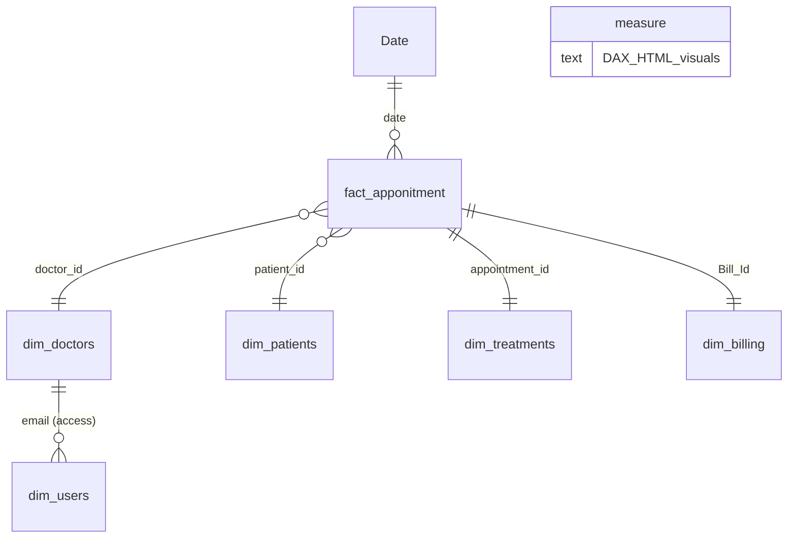

# Hospital-Operations-Revenue-Dashboard
A secure, doctor-personalised Power BI experience that turns raw appointment, treatment and billing records into decisions.
# 🏥 Hospital Operations & Revenue Dashboard

> **A secure, doctor-personalised Power BI experience that turns raw appointment, treatment and billing records into decisions.**

---

##  TL;DR (Executive Summary)

| | |
|---|---|
| **What it is** | A 5-page Power BI report for a 3-branch hospital group, with doctor login and custom-designed visuals |
| **Data** | 200 appointments · 50 patients · 10 doctors · 3 branches · 5 treatment types · 200 bills (all of 2023) |
| **Core finding** | **Only 23% of appointments were completed** and **only 31.5% of billed revenue was actually paid** |
| **Money at stake** | **551,250 billed → 173,425 collected.** About **377,825 is pending or failed** |
| **Biggest operational issue** | **No-shows (26%) and cancellations (25.5%) take up more than half of all appointment slots** |
| **Biggest quick win** | Fix the **3 PM overload** and reminder/payment follow-up. Both are cheap and fast to act on |

---

## 📖 The Story

**Chapter 1: The problem.**
A hospital group runs three sites (Central Hospital, Eastside Clinic, Westside Clinic) with 10 doctors across Pediatrics, Dermatology and Oncology. Data sits in separate tables: appointments, treatments, billing, patients and doctors. Nobody can answer simple questions quickly:

- *Are we using our doctors' time well?*
- *How many booked patients actually show up?*
- *Are we getting paid for the work we do?*
- *When are we overloaded, and when are we idle?*

**Chapter 2: The solution.**
All tables are connected into one star-schema model, and a report is built on top of it. It opens on a welcome page, and each doctor "signs in" with their email to see **only their own patients, appointments and treatments**. A manager (admin) sees the whole hospital.

**Chapter 3: What the data reveals.**
The dashboard shows a hospital that is **busy but not productive**: lots of bookings, but fewer than 1 in 4 becomes a completed visit, and less than a third of the billed money is collected. The sections below explain where the leaks are.

**Chapter 4: What to do next.**
Targeted actions: reminders, double-booking rules, payment follow-up, branch and doctor balancing. They are listed in the [Recommendations](#-recommendations) section, with priorities.

---

## Business Problems This Project Solves

| # | Business problem | How the dashboard solves it |
|---|---|---|
| 1 | **No single view of hospital performance** | One KPI page: patients, appointments, completion rate, revenue billed vs. collected |
| 2 | **Lost capacity from no-shows and cancellations** | Status tracking (Completed / Scheduled / Cancelled / No-show) by doctor, branch and visit reason |
| 3 | **Revenue leakage** | Billed vs. collected, with payment status (Paid / Pending / Failed) and payment method |
| 4 | **Overloaded and idle time slots** | "Appointments by hour" chart flags hours more than 25% above average |
| 5 | **Uneven doctor workload** | Doctors page: workload, specialization, branch, experience |
| 6 | **Patient privacy and role-based access** | Row-Level Security: each doctor sees only their own data via login email |
| 7 | **Not knowing which services make money** | Treatments page: usage, revenue "podium", and price vs. demand |
| 8 | **Seasonality and planning** | Monthly trend with peak-month callout (April) |

---

##  Report Structure (5 Pages)

| Page | Purpose | What it shows |
|---|---|---|
| **Welcome** | Entry and sign-in | Animated start page and the doctor email selector. Data stays locked until a doctor is chosen |
| **Overview** | Hospital-wide health check | KPI cards, appointments by month, patients by gender, appointments by hour, top visit reasons |
| **Doctors** | Workforce view | Doctor profile card: specialization, branch, experience, workload |
| **Patients** | Patient and status board | Patient badges and appointment-status breakdown |
| **Treatments** | Service and revenue view | Treatment usage, revenue podium, price vs. demand |

---

## Data Model (Star Schema)

| Table | Role | Key fields |
|---|---|---|
| `fact_apponitment` | Fact | appointment date and time, reason for visit, status, treatment cost, bill date and amount |
| `dim_doctors` | Dimension | name, specialization, years of experience, branch, email |
| `dim_patients` | Dimension | gender, date of birth, address, insurance provider |
| `dim_treatments` | Dimension | treatment type, description, cost, date |
| `dim_billing` | Dimension | amount, payment method, payment status |
| `dim_users` | Security | email and role (Admin) |
| `Date` | Calendar | Year, month, quarter, day |
| `measure` | Measures | All DAX measures (KPI logic and HTML/CSS visuals) |

---

## What Makes This Project Special

-  **Fully custom visuals built with DAX + HTML/CSS.** The cards, charts and badges are generated by measures (for example `KPI Cards HTML`, `Busy Hours Chart HTML`, `Treatments Revenue Podium HTML`) and rendered through an HTML content visual. The result is a design far beyond default Power BI charts, with gradients, animations and a consistent ocean-blue theme (`Theme CSS`).
-  **Row-Level Security with a login experience.** A `doctor` role filters data with `LOWER(TRIM(dim_doctors[email])) = LOWER(USERPRINCIPALNAME())`. On the report, a "Sign in to continue" locked state appears until a doctor is selected, and a "Signed In As" label shows who is viewing. The `All doctors (admin)` view is available for the manager.
-  **Smart, self-explaining visuals.** Overloaded hours are highlighted automatically (25% above average), and the peak month and busiest hour are called out directly on the charts.
- **Clean star-schema model** with a proper calendar table, ready to extend.

---

## Key Insights

### 1. Appointment outcomes: the biggest problem

| Status | Appointments | Share |
|---|---|---|
| Completed | 46 | **23.0%** |
| No-show | 52 | 26.0% |
| Cancelled | 51 | 25.5% |
| Scheduled | 51 | 25.5% |

- **51.5% of all slots (103) were lost** to no-shows and cancellations.
- Another 51 appointments (25.5%) are still marked "Scheduled" even though every appointment date falls in 2023. These are likely **stale statuses that were never updated**, which also drags the completion rate down.
- **Consultation** has the weakest follow-through: only **4 of 43** were completed (about 9%). **Checkup** is the best at 16 of 45 (about 36%).
- **Therapy** has the most no-shows (15), and **62% of Emergency** appointments (18 of 29) ended as cancelled or no-show, which is unusual for urgent care and worth investigating.

### 2. Revenue: billed is not collected

| Payment status | Bills | Amount | Share |
|---|---|---|---|
| Paid | 64 | 173,425 | **31.5%** |
| Pending | 69 | 184,612 | 33.5% |
| Failed | 67 | 193,213 | **35.1%** |
| **Total billed** | 200 | **551,250** | 100% |

- **Failed payments are the largest bucket**, bigger than paid. This is a payment-process problem, not just slow customers.
- **Cash has the highest failure rate (38%)**, versus 33% for insurance and 31% for credit card.
-  **Billing logic needs validation:** every appointment has a bill, including cancelled and no-show ones. Only about **124,100** of the billed amount sits on completed appointments. If cancelled and no-show visits should not be billed, reported revenue is overstated.

### 3. Time and seasonality

- **Peak month:** April (25 appointments). **Lowest:** September (11).
- **First half of the year carries 57.5%** of volume (115 vs. 85 appointments).
- **3 PM is the only overloaded hour** (28 appointments, about 40% above the hourly average of 20), while **4 PM is the quietest** (15).

### 4. Doctors and branches

- **Workload is uneven:** Sarah Taylor handles **29** appointments (and the most revenue, about 82,700), while Robert Davis handles **13**, a 2.2x gap.
- **Completion varies a lot by doctor:** from about **14%** (Sarah Taylor) to about **38%** (Robert Davis). Interestingly, the busiest doctor has the lowest completion rate.
- **Central Hospital carries 42% of appointments** (84) and has the lowest completion rate (about 18%), versus about 26% at Eastside and 28% at Westside.
- **Pediatrics** is the largest specialty (98 appointments, about 259,000 billed).

### 5. Treatments

- **Chemotherapy** is the most used (49 treatments) and the top earner (about 128,900).
- **MRI** has the highest average price (about 3,225) and ranks second in revenue, so it is high value per visit.
- **ECG** is the lowest in revenue (about 96,200) and **Physiotherapy** is second lowest (about 99,400).

### 6. Patients

- **50 registered patients**, of which **48 booked** at least one appointment (2 have never booked).
- **Average of about 4.2 appointments per patient**, which indicates a strong base of returning patients. One patient (P012) has 10 visits.
- **62% male / 38% female.** Ages range from 21 to 76, with an average of about 46.
- Insurance mix: MedCare Plus (18), WellnessCorp (16), PulseSecure (10), HealthIndia (6).

---

## 💡 Recommendations

### 🔴 Priority 1: Quick wins (0–30 days)

1. **Launch automated reminders** (SMS/WhatsApp, 48h and 2h before). No-shows and cancellations are over half of all slots, so even a modest improvement recovers a large amount of capacity.
2. **Clean up appointment statuses.** Close out the 51 stale "Scheduled" records so the completion rate reflects reality.
3. **Chase failed and pending payments.** About **377,825** is uncollected. Start with the 67 failed payments (193,213) and retry them or contact patients.
4. **Rebalance 3 PM.** Move or open slots at 4 PM and other quiet hours, and cap the 3 PM load.

###  Priority 2: Process fixes (1–3 months)

5. **Review the billing rules.** Decide whether cancelled and no-show appointments should generate bills. Consider a **no-show fee or deposit** for high-risk visit types such as Therapy.
6. **Fix the Consultation and Emergency flows.** Find out why Consultation completes at about 9% and why most Emergency appointments end in cancellation or no-show (booking process, triage, or data entry?).
7. **Review cash payments.** Their 38% failure rate is the highest, so encourage card or insurance payment at check-in.
8. **Balance doctor workload.** Redistribute bookings from the busiest doctors to those with spare capacity, and investigate why Sarah Taylor has the lowest completion rate despite the highest volume.

###  Priority 3: Strategic (3–12 months)

9. **Plan staffing around seasonality.** Add capacity for the spring peak (Q2) and run campaigns in the slow months (September, December).
10. **Promote high-value services.** Grow MRI and Chemotherapy capacity, and review pricing and promotion for ECG and Physiotherapy.
11. **Investigate Central Hospital.** It has the highest volume and the lowest completion. Look at staffing, scheduling and process.
12. **Improve patient retention.** Follow up with the 2 patients who never booked, and build loyalty for high-frequency patients.

---

##  Data Quality Notes

These are worth fixing before sharing results externally:

- **Patient count mismatch:** the KPI card shows **48** (patients with appointments), while the gender chart shows **50** (all registered patients).
- **Pediatrics vs. patient ages:** Pediatrics has the most appointments, yet no patient in the data is under 21. Check whether specialization labels or patient records are correct.
- **Single year of data:** all appointments are from **2023**, so trends are not comparable across years.
- **Table name typo:** `fact_apponitment` should be `fact_appointment`. Renaming is safer done early.
- **Dimension tables hold transactional data:** `dim_treatments` and `dim_billing` have one row per appointment (1:1 with the fact table), so they behave more like fact tables. Consider remodelling if the project grows.
- **Bi-directional filters** are used on the patient, treatment and billing relationships. This works, but can cause ambiguity as the model grows.

---

## How to Use

1. Open `hospital.pbix` in **Power BI Desktop**.
2. Go to the **Welcome** page and select a **doctor email** to sign in, or leave the selection open for the admin view.
3. Navigate with the page navigator: **Overview → Doctors → Patients → Treatments**.
4. To enforce security in the Power BI Service, assign users to the **`doctor`** role and make sure each user's login email matches `dim_doctors[email]`.

> **Note:** the HTML visuals require an **HTML Content** custom visual to be available in your Power BI environment.

---

## Tech Stack

`Power BI` · `DAX` · `HTML / CSS (inside DAX measures)` · `Row-Level Security` · `Star-schema data modelling`

---

## Future Improvements

- Add **no-show prediction** to flag high-risk appointments in advance
- Add **multi-year data** for true year-over-year analysis
- Add **wait-time and doctor-utilisation** metrics
- Add a **collections aging** view (how long bills stay unpaid)
- Add **drill-through** from branch to doctor to patient

---

<i>Built to turn hospital data into faster, safer and more profitable decisions.</i>

