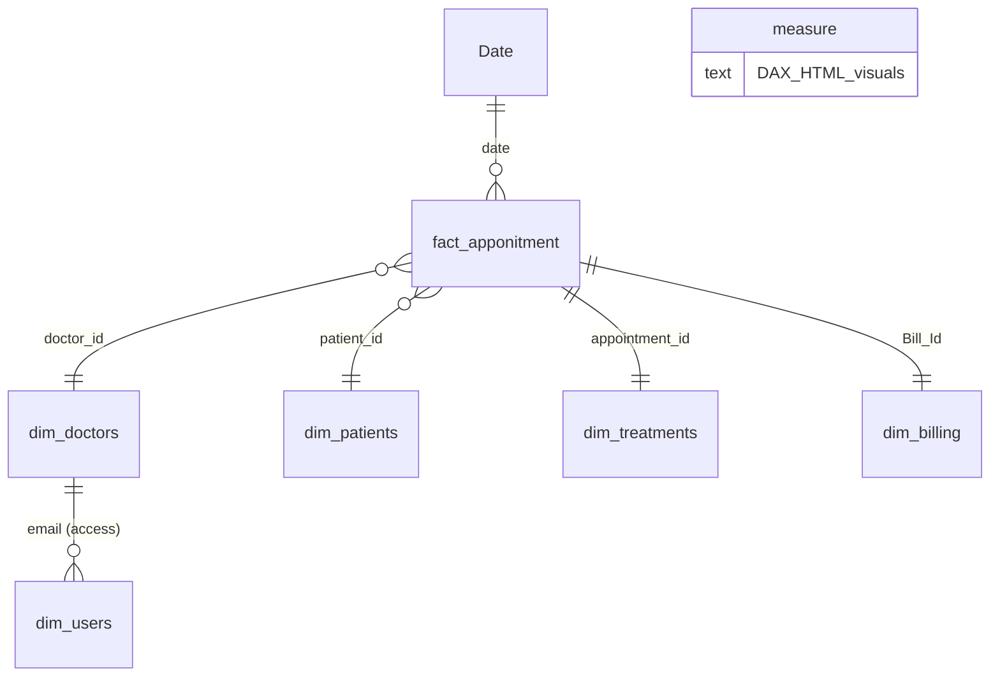

# Hospital Appointments & Revenue Dashboard

> **A Power BI dashboard with custom-designed visuals that turns appointment, patient and billing data into clear, actionable insights.**

---

## Demo

---

## (Executive Summary)

| | |
|---|---|
| **What it is** | A hospital performance dashboard covering patients, appointments, visit reasons, timing and revenue |
| **Scale** | **48 patients · 200 appointments · 551,250 billed** |
| **Core finding** | **Only 23.0% of appointments were completed** (46 of 200) |
| **Money at stake** | **173,425 collected out of 551,250 billed** (about 31.5%), leaving **377,825 outstanding** |
| **Busiest time** | **April** (month) and **3 PM** (hour of day) |
| **Main visit reasons** | Checkup (45), Consultation (43), Therapy (42), Follow-up (41), Emergency (29) |

---

##  The Story

**Chapter 1: The problem.**
A hospital books hundreds of appointments a year, but its data is scattered, so management cannot quickly answer:

- *How many patients and appointments do we handle, and how many are actually completed?*
- *How much revenue do we bill, and how much do we really collect?*
- *When are we busiest, and when do we have spare capacity?*
- *Why are patients coming to us?*

**Chapter 2: The solution.**
One dashboard brings it all together. Four KPI cards give the big picture at a glance, and four visuals explain the details: **monthly demand, patient gender mix, hourly load, and top visit reasons**.

**Chapter 3: What the dashboard reveals.**
The hospital is **busy but not converting**: 200 appointments were booked, but only 46 were completed, and less than a third of the billed amount has been collected. Demand is also uneven, peaking in spring and at 3 PM.

**Chapter 4: What to do next.**
Focus on completing more booked appointments, collecting outstanding revenue, and smoothing the schedule. The [Recommendations](#-recommendations) section lists the steps.

---

##  Business Problems This Dashboard Solves

| # | Business problem | How the dashboard helps |
|---|---|---|
| 1 | **No quick view of overall performance** | Four KPI cards: patients, appointments, completion rate, revenue billed vs. collected |
| 2 | **Booked appointments that never get completed** | Completion rate KPI (23.0%, completed vs. total) |
| 3 | **Billed revenue that is not collected** | Revenue card shows 551,250 billed against 173,425 collected |
| 4 | **Overloaded and quiet time slots** | Hour-of-day chart highlights overloaded hours (more than 25% above average) |
| 5 | **Unclear seasonality** | Monthly trend with a peak-month callout (April) |
| 6 | **Not knowing why patients visit** | Top visit reasons ranked by number of appointments |
| 7 | **No picture of the patient base** | Gender split of patients (62% male, 38% female) |

---

---

## Data Model (Star Schema)

| Table | Role | Key fields |
|---|---|---|
| `fact_apponitment` | Fact | appointment date and time, reason for visit, status, treatment cost, bill date and amount |
| `dim_doctors` | Dimension | name, specialization, years of experience, branch, email |
| `dim_patients` | Dimension | gender, date of birth, address, insurance provider |
| `dim_treatments` | Dimension | treatment type, description, cost, date |
| `dim_billing` | Dimension | amount, payment method, payment status |
| `dim_users` | Security | email and role (Admin) |
| `Date` | Calendar | Year, month, quarter, day |
| `measure` | Measures | All DAX measures (KPI logic and HTML/CSS visuals) |

---

##  What Makes This Project Special

- **Fully custom visuals built with DAX + HTML/CSS.** Cards, charts and bars are generated by measures instead of default Power BI visuals, giving a polished ocean-blue design with gradients and glow effects.
- **Self-explaining visuals.** Overloaded hours are highlighted automatically with light bars, and the peak month and busiest hour appear as call-out badges.
- **Row-Level Security with a doctor login experience** in the report file, so each doctor can see only their own data while an admin sees everything.
- **Star-schema data model** with fact and dimension tables (appointments, patients, doctors, treatments, billing) and a calendar table.
- **Multi-page report:** Welcome, Overview, Doctors, Patients and Treatments pages. The insights below come from the **Overview** dashboard.

---

## Key Insights (from the Dashboard)

### 1. KPI cards: the big picture

| KPI | Value | Note |
|---|---|---|
| Patients | **48** | Unique patients |
| Appointments | **200** | 46 completed |
| Completion rate | **23.0%** | Completed vs. total |
| Revenue billed | **551,250** | 173,425 collected |

- **Completion rate is low.** Only **46 of 200** appointments (23.0%) were completed, so about **3 out of 4** were not.
- **Collection rate is about 31.5%.** Only 173,425 of 551,250 billed has been collected, leaving about **377,825 outstanding**.
- **About 4 appointments per patient** (200 / 48), which suggests many returning patients.
- **Average billed amount is about 2,756 per appointment** (551,250 / 200).

### 2. Appointments by month

| Jan | Feb | Mar | Apr | May | Jun | Jul | Aug | Sep | Oct | Nov | Dec |
|---|---|---|---|---|---|---|---|---|---|---|---|
| 20 | 14 | 19 | **25** | 19 | 18 | 16 | 15 | **11** | 14 | 17 | 12 |

- **Peak month is April (25 appointments)**, shown as a call-out on the chart.
- **Lowest month is September (11 appointments)**, less than half of the April peak.
- **Demand is front-loaded.** January to June has **115 appointments (57.5%)**, versus **85 (42.5%)** from July to December.
- After April, volume declines steadily to September, with a small recovery in November (17) before dropping again in December (12).

### 3. Patients by gender

- **62.0% male (31)** and **38.0% female (19)**, out of **50 total patients**.
- Male patients are a clear majority. This may reflect the hospital's services, or it may be an outreach opportunity for female patients.
- **Data check:** the gender chart counts **50** patients, while the Patients KPI shows **48**. This 2-patient gap should be reconciled.

### 4. Appointments by hour of day

| 8 AM | 9 AM | 10 AM | 11 AM | 12 PM | 1 PM | 2 PM | 3 PM | 4 PM | 5 PM |
|---|---|---|---|---|---|---|---|---|---|
| 21 | 17 | 19 | 18 | 21 | 20 | 20 | **28** | **15** | 21 |

- **Busiest hour is 3 PM (28 appointments)**, about **40% above the hourly average of 20**. It is the **only overloaded hour** (the dashboard counts 1).
- **4 PM is the quietest hour (15 appointments)**, right after the peak.
- All other hours are fairly balanced at **17 to 21 appointments**.

### 5. Top visit reasons

| Reason | Appointments | Share |
|---|---|---|
| Checkup | 45 | 22.5% |
| Consultation | 43 | 21.5% |
| Therapy | 42 | 21.0% |
| Follow-up | 41 | 20.5% |
| Emergency | 29 | 14.5% |

- **Demand is evenly spread.** The top four reasons are within 4 appointments of each other (41 to 45).
- **Checkup** is the most common reason, followed closely by **Consultation**.
- **Emergency is the least frequent (29, or 14.5%)**, but it still needs capacity kept in reserve.
- **Follow-ups (41)** support the picture of returning patients.

---

## Recommendations

### Priority 1: Quick wins

1. **Raise the completion rate.** Only 23.0% of appointments are completed. Introduce automated reminders (SMS or WhatsApp) before each appointment and track why appointments are not completed.
2. **Collect outstanding revenue.** About 377,825 of the 551,250 billed is uncollected. Set up a follow-up process for unpaid bills.
3. **Rebalance the 3 PM peak.** Move some bookings to 4 PM (15 appointments), the quietest hour, to reduce overload and waiting time.

### Priority 2: Planning

4. **Staff for the spring peak.** April is the busiest month (25), so plan doctors and rooms for the first half of the year, when 57.5% of appointments happen.
5. **Lift the slow months.** September (11) and December (12) are the quietest. Use campaigns, checkup packages or reminders to bring demand up.
6. **Keep emergency capacity ready.** Emergency visits are 14.5% of volume (29), so reserve slots for them.

###  Priority 3: Growth and data

7. **Grow checkups and consultations.** They are the top two reasons, so package and promote them (for example, annual checkup plans).
8. **Improve outreach to female patients.** They make up only 38% of patients.
9. **Reconcile the patient count** (48 vs. 50) so all KPIs match.
10. **Extend the dashboard** with an appointment-status breakdown (completed, cancelled, no-show) and payment status, so the causes behind the low completion and collection rates are visible.

---

## How to Use

1. Open `hospital.pbix` in **Power BI Desktop**.
2. Start on the **Welcome** page and choose a doctor email, or use the admin view.
3. Open the **Overview** page to see the KPIs and charts described above.
4. Use the page navigator to explore the other pages.

> **Note:** the HTML visuals require an **HTML Content** custom visual to be available in your Power BI environment.

---

## Tech Stack

`Power BI` · `DAX` · `HTML / CSS (inside DAX measures)` · `Row-Level Security` · `Star-schema data modelling`

---

<i>Built to turn hospital data into faster, clearer and more profitable decisions.</i>

